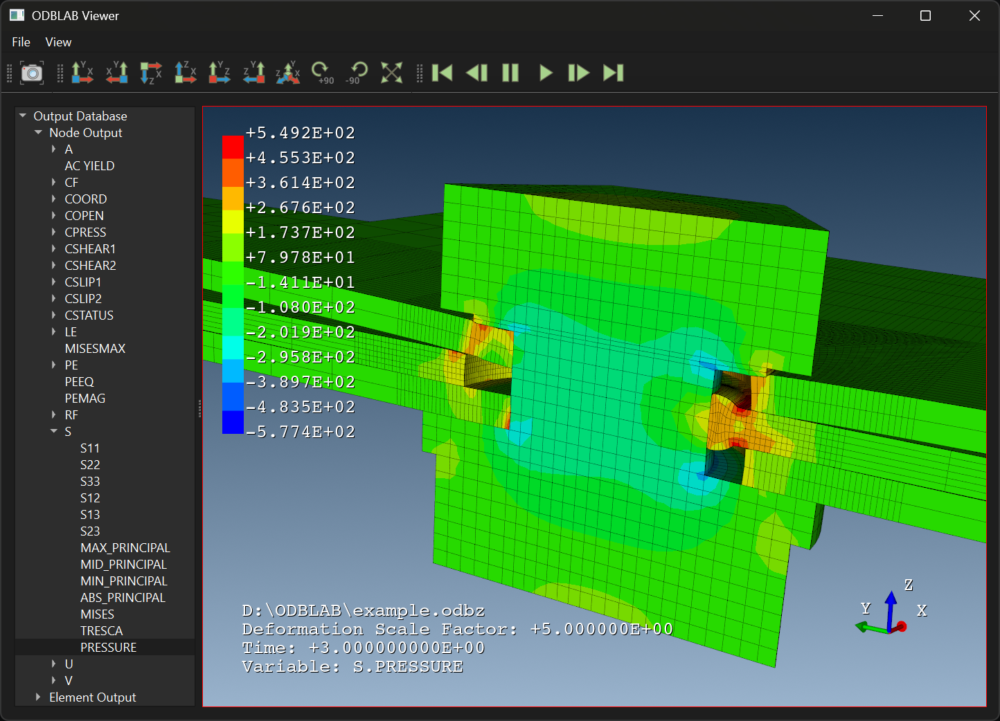

# ODBLAB: Post-Processor for Abaqus and Ansys

**ODBLAB** (from Output DataBase LABoratory) provides a unified, easy-to-use workflow for post-processing Abaqus and Ansys results in Python by extracting the finite element mesh and field output data into a portable, non-proprietary, NumPy-based format. It also includes a fully featured viewer application based on Qt and VTK.

**ODBLAB** is free and open-source software distributed under the [GPLv3 licence](https://spdx.org/licenses/GPL-3.0-only.html).

You can also use **ODBLAB** from MATLAB with the [MATLAB wrapper](odblab-matlab/odblab.m)!

## How Does It Work?

**ODBLAB** first converts an Abaqus Output Database (`*.odb`) or an Ansys Results File (`*.rst`) into a portable, open (i.e., non-proprietary) `*.odbz` or `*.rstz` file, respectively. These files are standard NumPy `*.npz` archives ([see the NPY/NPZ format](https://numpy.org/doc/stable/reference/generated/numpy.lib.format.html)). They also serve as cache: when the original `*.odb` or `*.rst` file is loaded again, **ODBLAB** reuses the corresponding `*.odbz` or `*.rstz` file if it is up to date, avoiding repeated extraction.

**ODBLAB** then provides a straightforward, easy-to-use interface for accessing the finite element mesh, retrieving field outputs, computing and storing derived results, and visualizing the extracted and post-processed data.

## Design and Features

**ODBLAB** aims to provide a unified post-processing workflow across Abaqus, Ansys, Python, and MATLAB. It is designed for practical engineering use, balancing computational efficiency, ease of use, and long-term maintainability. The following features reflect these design priorities:

- **Unified Abaqus and Ansys data model:** Results from both solvers are exposed using the same database structure and API, enabling solver-independent post-processing workflows.

- **Straightforward array representation:** Mesh and results are exposed as regular NumPy arrays in Python and native arrays in MATLAB, making them easy to work with in familiar vectorized workflows.

- **Unified finite element mesh:** Abaqus assemblies and instances are mapped into a single, unified global mesh, simplifying post-processing and ensuring compatibility with the unified Abaqus-Ansys data model.

- **Efficient post-processing:** Results can be retrieved at nodes or element centroids and optionally filtered by region and/or specific time frames, making it easy to focus computations on critical regions and relevant stages of the analysis.

- **Portable and extensible result files:** Extracted and post-processed results can be stored in open, transferable archives and explored in the built-in viewer.

### Result Positions

**ODBLAB** exposes field output data at mesh nodes and element centroids, regardless of the original solver:

| Typical Results | Original Solver Position | Available ODBLAB Position |
| --- | --- | --- |
| Displacement (`U`), Reaction Force (`RF`) | Mesh nodes | Mesh nodes |
| Element Volume (`EVOL`) | Element centroids | Element centroids |
| Stress (`S`), Strain (`E`) | Integration points (Abaqus), element nodes (Ansys) | Mesh nodes and element centroids |

When the available position differs from the original position, results are obtained by interpolation/extrapolation using the original solver. Unique nodal values are obtained by averaging contributions from adjacent elements (known as smoothing).

### Computed Invariants

**ODBLAB** automatically detects vector and tensor fields, computes their invariants, and stores them alongside the extracted field outputs:

| Field Type | Computed Invariant | Output Suffix |
| --- | --- | --- |
| Vector | Magnitude | `MAGNITUDE` |
| Tensor | Maximum principal value | `MAX_PRINCIPAL` |
| Tensor | Intermediate principal value | `MID_PRINCIPAL` |
| Tensor | Minimum principal value | `MIN_PRINCIPAL` |
| Tensor | Absolute maximum principal value | `ABS_PRINCIPAL` |
| Stress tensor (`S`) | von Mises equivalent stress | `MISES` |
| Stress tensor (`S`) | Tresca equivalent stress | `TRESCA` |
| Stress tensor (`S`) | Pressure | `PRESSURE` |

Where applicable, invariants are computed after extrapolation and nodal smoothing. To compare ODBLAB with Abaqus, enable *Compute scalars after averaging* under *Result > Options...* in Abaqus/Viewer.

### Known Limitations

**ODBLAB** currently supports 2D and 3D solid element models with a fixed mesh. Shells, beams, and models involving remeshing are not supported.

## Installation

### Requirements

Abaqus must be installed to extract `*.odb` files, and Ansys must be installed to extract `*.rst` files. Once extracted, the resulting `*.odbz` and `*.rstz` files can be loaded directly without repeating the extraction.

### For Python Users

Install **ODBLAB** from PyPI using `pip install odblab`. **Python 3.10 or later is required.**

### For MATLAB Users

**Python 3.10 or later is required.** MATLAB R2022b is the earliest release supporting Python 3.10. If using a newer Python version, check the [MATLAB-Python compatibility table](https://www.mathworks.com/support/requirements/python-compatibility.html). You can use [`pyenv`](https://www.mathworks.com/help/matlab/ref/pyenv.html) to verify or configure the Python interpreter used by MATLAB.

Once Python is available to MATLAB, simply [download the MATLAB wrapper](odblab-matlab/odblab.m) and place `odblab.m` in the current folder or on the MATLAB path. If necessary, the wrapper will ask for permission to run `pip install odblab` automatically.

## Usage

The following examples demonstrate the **ODBLAB** workflow in both Python and MATLAB.

### Load and View a Database

Loading an Abaqus Output Database (`*.odb`) or an Ansys Results File (`*.rst`) requires a single function call. **ODBLAB** automatically extracts the data when necessary and reuses the corresponding `*.odbz` or `*.rstz` cache on subsequent calls. The `*.odbz` and `*.rstz` files can also be loaded directly.

#### Python

```python
import odblab                   # import the ODBLAB package
db = odblab.load("example.odb") # load an Abaqus database
print(db)                       # inspect the database
odblab.view(db)                 # open the viewer application
```

#### MATLAB

```matlab
% 'odblab.m' must be in the current folder or on the MATLAB path
db = odblab.load("example.odb"); % load an Abaqus database
disp(db);                        % inspect the database
odblab.view(db);                 % open the viewer application
```

#### Output

Example of a double-lap bolted joint model under tensile loading with bolt preload.



### Retrieve Field Output Data

Use `get` to retrieve one or more field outputs at the mesh nodes or element centroids. For example, the stress components and invariants can be retrieved for the whole model and all available time frames as follows:

#### Python

```python
position = "nodes" # or "centroids"
[s11, s22, s33, s12, s23, s31] = db.get(["S.S11", "S.S22", "S.S33", "S.S12", "S.S23", "S.S13"], position)
[s1, s2, s3, s1_abs] = db.get(["S.MAX_PRINCIPAL", "S.MID_PRINCIPAL", "S.MIN_PRINCIPAL", "S.ABS_PRINCIPAL"], position)
[mises, tresca, pressure] = db.get(["S.MISES", "S.TRESCA", "S.PRESSURE"], position)
```

#### MATLAB

```matlab
position = "nodes"; % or "centroids"
[s11, s22, s33, s12, s23, s31] = db.get(["S.S11", "S.S22", "S.S33", "S.S12", "S.S23", "S.S13"], position);
[s1, s2, s3, s1_abs] = db.get(["S.MAX_PRINCIPAL", "S.MID_PRINCIPAL", "S.MIN_PRINCIPAL", "S.ABS_PRINCIPAL"], position);
[mises, tresca, pressure] = db.get(["S.MISES", "S.TRESCA", "S.PRESSURE"], position);
```

Each returned matrix has one row per node (if `position="nodes"`) or element (if `position="centroids"`) and one column per time frame. If a field is unavailable for a particular region or time frame, the corresponding value is [NaN](https://en.wikipedia.org/wiki/NaN). For example, equivalent plastic strain (`PEEQ`) is only available in regions undergoing plastic deformation, so elastic regions return NaN.

Results can also be restricted to a specific region and/or selected time frames. For nodal results, `region` must be a node set name; for elemental/centroidal results, it must be an element set name. The `frames` parameter accepts a boolean filter over `db.times`. For example:

#### Python

```python
region = "PLATE-1.CRITICAL_PLATE_SURFACE"     # critical region
frames = (db.times > 3.0) & (db.times <= 4.0) # for t in (3, 4]
[u1, u2, u3] = db.get(["U.U1", "U.U2", "U.U3"], "nodes", region=region, frames=frames)
```

#### MATLAB

```matlab
region = "PLATE-1.CRITICAL_PLATE_SURFACE";     % critical region
frames = (db.times > 3.0) & (db.times <= 4.0); % for t in (3, 4]
[u1, u2, u3] = db.get(["U.U1", "U.U2", "U.U3"], "nodes", region=region, frames=frames);
```

### Typical Post-Processing Workflow

The following example demonstrates a typical **ODBLAB** workflow: loading and inspecting an Abaqus Output Database (`*.odb`), retrieving displacement and stress components for a selected region and time interval, computing derived results, adding them to the database, saving the updated database, and visualizing the results in the built-in viewer.

#### Python

```python
import odblab
import numpy as np

# load and inspect the database
db = odblab.load("example.odb")
print(db)

# select region and time frames
region = "PLATE-1.CRITICAL_PLATE_SURFACE"
frames = (db.times > 3.0) & (db.times <= 4.0)

# retrieve nodal field outputs
[u1, u2, u3] = db.get(["U.U1", "U.U2", "U.U3"], "nodes", region=region, frames=frames)
[s11, s22, s33, s12, s23, s31] = db.get(["S.S11", "S.S22", "S.S33", "S.S12", "S.S23", "S.S13"], "nodes", region=region, frames=frames)

# post-processing (simple example)
disp_magnitude = np.sqrt(u1**2 + u2**2 + u3**2)
mises = np.sqrt(0.5*((s11 - s22)**2 + (s22 - s33)**2 + (s33 - s11)**2) + 3*(s12**2 + s23**2 + s31**2))

# add the post-processed results to the database
db.add({"USER.MISES": mises, "USER.DISP_MAGNITUDE": disp_magnitude}, "nodes", region=region, frames=frames)
db.save() # save the updated database to disk (optional)

# open the viewer to inspect the results
odblab.view(db)
```

#### MATLAB

```matlab
% 'odblab.m' must be in the current folder or on the MATLAB path

% load and inspect the database
db = odblab.load("example.odb");
disp(db);

% select region and time frames
region = "PLATE-1.CRITICAL_PLATE_SURFACE";
frames = (db.times > 3.0) & (db.times <= 4.0);

% retrieve nodal field outputs
[u1, u2, u3] = db.get(["U.U1", "U.U2", "U.U3"], "nodes", region=region, frames=frames);
[s11, s22, s33, s12, s23, s31] = db.get(["S.S11", "S.S22", "S.S33", "S.S12", "S.S23", "S.S13"], "nodes", region=region, frames=frames);

% post-processing (simple example)
disp_magnitude = sqrt(u1.^2 + u2.^2 + u3.^2);
mises = sqrt(0.5*((s11 - s22).^2 + (s22 - s33).^2 + (s33 - s11).^2) + 3*(s12.^2 + s23.^2 + s31.^2));

% add the post-processed results to the database
db.add({"USER.MISES", mises, "USER.DISP_MAGNITUDE", disp_magnitude}, "nodes", region=region, frames=frames);
db.save(); % save the updated database to disk (optional)

% open the viewer to inspect the results
odblab.view(db);
```

The `db.add` method stores the derived fields at the requested position, region, and time frames, filling values outside the selection with NaN. The `db.save` method writes the updated database to its `*.odbz` or `*.rstz` file. The new `USER.MISES` and `USER.DISP_MAGNITUDE` fields can then be retrieved and visualized like any field extracted from the original solver database.

---

Copyright © 2026, Carlos Souto and Diego Salamanca
